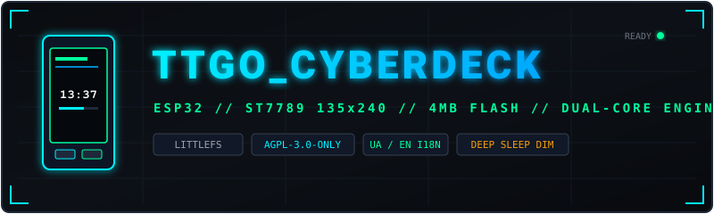

<p align="center">
  
</p>

<p align="center">
  <a href="https://github.com/TexnoM/TTGO_CyberDeck/blob/main/LICENSE"></a>
  
  
  
  
</p>

> [!NOTE]
> **[Українська версія документації доступна у файлі README_UA.md](README_UA.md)**

```
================================================================================
  _______ _______ _____  ____     _______     _               _____            _
 |__   __|__   __/ ____|/ __ \   / ____\ \   / /             |  __ \          | |
    | |     | | | |  __| |  | | | |     \ \_/ /__ _ __ ______| |  | | ___  ___| | __
    | |     | | | | |_ | |  | | | |      \   / _ \ '__|______| |  | |/ _ \/ __| |/ /
    | |     | | | |__| | |__| | | |____   | |  __/ |         | |__| |  __/ (__|   < 
    |_|     |_|  \_____|\____/   \_____|  |_|\___|_|         |_____/ \___|\___|_|\_\
================================================================================
               POCKET CYBERDECK FIRMWARE FOR LILYGO TTGO T-DISPLAY 1.14"
```

**TTGO_CyberDeck** is an embedded firmware engineered for Chinese clones and official revisions of the **LilyGO TTGO T-Display 1.14" ESP32** development board (ST7789 IPS 135x240, 2 tactile buttons, USB-C). Designed as a compact cyberpunk pocket console and functional keychain computer.

---

## 1. Keychain & Hardware Gallery

<p align="center">
  
  &nbsp;&nbsp;&nbsp;&nbsp;
  
</p>

> Photos of custom cases, 3D-printed bezels, and keychain straps can be placed inside [`docs/images/`](docs/images/) under `keychain_front.png` and `keychain_side.png`.

---

## 2. Core Architecture & Features

### Graphics Pipeline & Hardware PWM
- **Zero-Flicker DMA Engine**: High-frequency SPI DMA transfers at `40 MHz` powered by LovyanGFX.
- **Hardware LEDC Backlight Dimming**: Dedicated ESP32 LEDC PWM controller on `GPIO 4` operating at `2 kHz` for smooth, flicker-free brightness scaling without CPU overhead.
- **Pure Minimalist Sleep Mode**:
  - Triggers automatically after idle timeout (default: `20s`, configurable in Settings).
  - Screen dims by 50% to prevent panel burn-in and save battery.
  - Displays **only the digital clock** (`HH:MM:SS`) on a pure black background.
  - Zero decorative clutter during sleep; touching any button immediately wakes the device.

### Storage & Internationalization
- **LittleFS Persistent Configuration**: All parameters (`theme`, `brightness`, `sleepTimeout`, `timezone`, `targetFps`, `language`) are stored in `/config.json` with fallback mirror to NVS.
- **Full Bilingual Support (UA / EN)**: Native UTF-8 Cyrillic rendering via high-resolution bitmap fonts. Switchable on the fly from the Settings menu.
- **4MB Flash Architecture**: Strictly engineered and budgeted for standard `4MB SPI Flash` modules (compatible with both 4MB and 16MB revisions).

### Integrated Cyberdeck Modules
1. **`SYSTEM`** — Real-time Dual-Core CPU load, free SRAM, MAC address, uptime, battery voltage and charge state.
2. **`WIFI RADAR`** — 2.4 GHz spectrum analyzer with RSSI signal meter, channel allocation, and encryption inspection.
3. **`PKT SNIFFER`** — Promiscuous 802.11 packet activity analyzer with 13-channel traffic distribution.
4. **`NET TOOLS`** — Network interface status and ICMP/TCP ping sonar with live latency histogram.
5. **`WEB DECK`** — Built-in HTTP console (`http://192.168.4.1`) for remote status inspection and Wi-Fi credential pairing.
6. **`CYBER EYE`** — Interactive cybernetic pet with procedural blinking and emotion expressions.
7. **`3D CUBE`** — Real-time 3D wireframe matrix projection with live FPS counter and frame timing.
8. **`TERMINAL`** — Embedded shell interface with built-in commands (`help`, `sysinfo`, `wifi`, `ping`, `cat`).
9. **`MATRIX`** — Digital glyph stream generator with adjustable density and speed.
10. **`STARFIELD`** — 3D cosmic warp space travel simulator.
11. **`CLOCK`** — Precision timekeeper supporting manual button adjustment, NTP Wi-Fi sync, and phone synchronization.
12. **`SETTINGS`** — System configuration interface: theme selection, backlight control, sleep timeout, language toggle (UA/EN), and diagnostics.

---

## 3. Hardware Pinout Matrix

Configured in [`include/hardware_config.h`](include/hardware_config.h):

| Function | Pin | Notes |
| :--- | :--- | :--- |
| **TFT MOSI** | `GPIO 19` | VSPI MOSI (40 MHz) |
| **TFT SCLK** | `GPIO 18` | VSPI SCLK |
| **TFT CS** | `GPIO 5` | Active LOW |
| **TFT DC** | `GPIO 16` | Data / Command |
| **TFT RST** | `GPIO 23` | Active LOW |
| **TFT BL** | `GPIO 4` | Hardware LEDC PWM (2 kHz) |
| **Button A** | `GPIO 0` | Boot / Navigation (Active LOW) |
| **Button B** | `GPIO 35` | Action / Select (Active LOW, internal pull-up required) |
| **Battery ADC** | `GPIO 34` | ADC1 CH6 via 100k/100k voltage divider |
| **ADC Enable** | `GPIO 14` | Power rail switch for voltage divider |

> [!IMPORTANT]
> **Blue Charging LED Notice**: The small blue LED located adjacent to the USB-C port is physically connected to Pin 1 (`CHRG`) of the onboard `TP4054` LiPo charge controller IC, not to an ESP32 GPIO. When the board is powered solely via USB without a battery connected to the JST port, the open-circuit condition causes the LED to cycle rapidly (10–20 Hz). This is an analog hardware characteristic of the charging circuit.

---

## 4. Input Navigation

The user interface is fully operated with two tactile buttons:

| Action | Navigation (Launcher) | Inside Applications |
| :--- | :--- | :--- |
| **Short Press A** | Next Application | Navigate list / Step parameter |
| **Short Press B** | Open Application | Select / Toggle / Confirm |
| **Long Press A** (`>520 ms`) | Previous Application | **Exit to Launcher** (saves settings) |
| **Long Press B** (`>520 ms`) | Quick Override Menu | Quick Override Menu |
| **Simultaneous A + B** | Next Color Theme | Next Color Theme |

---

## 5. Building & Flashing

### Option A: Flash Precompiled Binary (Linux)
```bash
# Connect device via USB
sudo ./flash_linux.sh
```
Or directly with `esptool`:
```bash
sudo esptool --chip esp32 -p /dev/ttyACM0 -b 921600 write_flash 0x0 release/TTGO_CyberDeck.bin
```

### Option B: Build from Source via PlatformIO
```bash
# Clone repository
git clone https://github.com/TexnoM/TTGO_CyberDeck.git
cd TTGO_CyberDeck

# Compile for 4MB Flash target
pio run -e ttgo-t-display-clone

# Upload firmware and flash partitions
pio run -e ttgo-t-display-clone -t upload
```

---

## 6. License

This project is licensed under the **GNU Affero General Public License v3.0 (AGPL-3.0)**.  
See the [`LICENSE`](LICENSE) file for the complete license terms.
